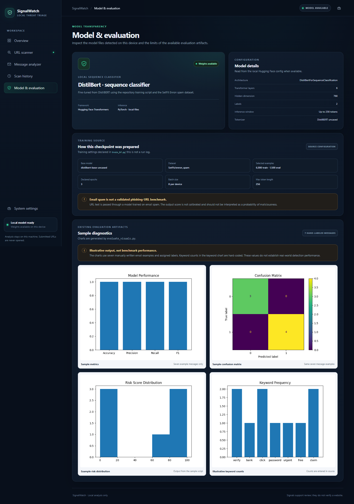
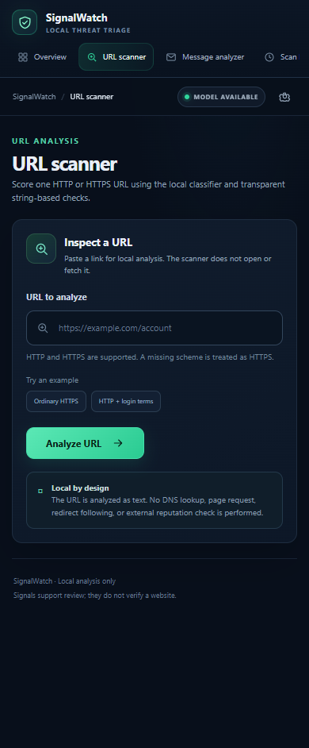
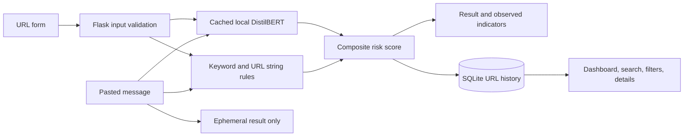

# Phishing Detector

### SignalWatch — local URL and message triage with a cached DistilBERT classifier and transparent pattern checks.

Phishing Detector is a Flask app for inspecting a URL or pasted message without opening the destination. It combines a locally loaded text classifier with simple keyword and URL-string heuristics, then shows the score components and observed patterns.

[](https://www.python.org/)
[](https://flask.palletsprojects.com/)
[](https://huggingface.co/docs/transformers)
[](https://pytorch.org/)
[](https://github.com/swarabhavsar28/phishing-detector)

> **A triage aid, not a safety guarantee.** A low score does not prove a URL or message is safe. Review suspicious content through a trusted channel.

---

## Product preview

Screenshots below were captured from the running application using the local model and example inputs. Dashboard counts and classifications shown are generated by those real scans; they are not seeded or hard-coded.

<p align="center"></p>

<p align="center"></p>

<p align="center"></p>

<p align="center"></p>

<p align="center"></p>

## What it does

- **URL scanner:** validates a single HTTP(S) URL, scores its text locally, and records the result in SQLite.
- **Message analyzer:** preserves the original pasted-email analysis flow; message bodies are processed in memory and are not stored.
- **Local model inference:** loads a Hugging Face sequence classifier once on the first analysis request and reuses it for later requests.
- **Transparent indicators:** reports configured keyword and hostname-pattern matches separately from the model score.
- **Persistent history:** search, filter, sort, and inspect saved URL scans; clear the local history with a confirmation prompt.
- **Real dashboard aggregates:** scan totals, score distribution, and recent activity are calculated from the local database.
- **Model & evaluation page:** reads model configuration when available and labels the existing charts as small-sample diagnostics.
- **Graceful model fallback:** the app starts if model files are missing; scans then show that they used heuristics only.
- **Local-only analysis:** submitted URLs are treated as text. The app does not resolve, visit, or fetch them.

Threat intelligence, DNS, WHOIS, TLS, redirects, and domain reputation checks are not implemented.

## Application flow



## How scoring works

The predictor retains the original two-class model and scoring convention. It takes the softmax score for model class `1`, multiplies it by 60, then adds 10 points per matched phishing keyword, 15 points per offer-related word, and URL-rule points. The score is capped at 100. If the model cannot be loaded or inference fails, the model component is omitted and the result is visibly marked **heuristic-only**.

Current thresholds:

| Composite score | Result |
| ---: | --- |
| 70–100 | High risk / phishing |
| 40–69.99 | Needs review |
| 0–39.99 | Low risk |

URL rules add points for `http://`, hostnames containing `login`, `verify`, or `bank`, hostnames with a hyphen, and hostnames with more than two dots. Keyword and URL matches are simple string checks. They are not an explanation of the model's internal decision.

The displayed **class 1 softmax score is not calibrated**. The model was trained on email spam labels, not an independently validated phishing-URL dataset. A score should not be interpreted as the probability that a URL is malicious.

The inference code treats model class `1` as the positive risk class. The training script passes dataset labels through without remapping, so verify the label order for the dataset and checkpoint you use.

## Model and evaluation

The training script starts with `distilbert-base-uncased`, loads `SetFit/enron_spam`, and declares a randomized 80/20 split of the dataset's training split. It selects up to 6,000 training and 1,500 evaluation examples, tokenizes to 256 tokens, and configures two labels, three epochs, and batch size eight. The saved tokenizer and model are written to `model/hf_model/`.

The saved evaluation charts come from `evaluate_visuals.py`, which runs seven manually written email examples with manually assigned labels. The metrics chart currently shows 1.00 for accuracy, precision, recall, and F1 on those seven examples, and the confusion matrix shows three true negatives and four true positives. These are only the results of that tiny example set, not a held-out or representative benchmark. The keyword chart uses counts hard-coded in the script.

<p align="center"></p>
<p align="center"></p>

Training arguments describe what the script requests; they are not proof that an existing checkpoint completed those settings. No independent validation report or phishing-URL benchmark is included.

## Data and privacy

- URL scan records are stored locally in `instance/scans.sqlite3` by default.
- SQLite records are not encrypted; keep the device and its local database access-controlled.
- History stores the URL without its query string or fragment to reduce accidental retention of tokens. The submitted URL is still analyzed in the active request.
- Pasted message bodies are not saved to SQLite or included in application logs.
- Logs include scan IDs, result categories, and error types, not submitted URL or message text.
- No URL is fetched, resolved, or sent to a third-party service.
- There is no authentication or rate limiting. The included Flask development server is intended for local use, not direct public exposure.

Use **Clear history** to delete saved URL scan records from the local database.

## Project structure

```text
phishing-detector/
├── app.py                         # Flask routes, validation, SQLite history, API
├── requirements.txt               # Web, inference, training, and chart dependencies
├── train_hf.py                    # Fine-tunes and saves the classifier
├── evaluate_visuals.py            # Generates the seven-example diagnostics
├── utils/
│   └── predictor.py               # Cached inference and URL/keyword heuristics
├── templates/                     # Dashboard, scanner, history, model, settings
├── static/                        # Responsive CSS, JavaScript, and favicon
├── tests/
│   └── test_app.py                # Backend and local-model integration tests
├── docs/screenshots/              # Genuine desktop and mobile app captures
├── graph_*.png                    # Existing evaluation visuals
├── model/hf_model/                # Local model files; ignored by Git
├── results/checkpoint-*/          # Local training checkpoints; ignored by Git
└── time pass                     # Legacy research scratch file, not used by app
```

The legacy `time pass` file contains unrelated transaction-graph preparation code and references external CSV files that are not part of this repository. It is not used by SignalWatch.

## Installation

### Requirements

- Python 3.13 was used for the local verification in this repository.
- The model is available locally at `model/hf_model/`, or can be created with the included training script.
- Model training requires internet access to download the base model and dataset from Hugging Face.

Create a virtual environment and install the declared dependencies from the repository root.

**Windows PowerShell**

```powershell
python -m venv .venv
.\.venv\Scripts\Activate.ps1
python -m pip install --upgrade pip
python -m pip install -r requirements.txt
```

**macOS / Linux**

```bash
python -m venv .venv
source .venv/bin/activate
python -m pip install --upgrade pip
python -m pip install -r requirements.txt
```

Model weights and training checkpoints are excluded from Git. A fresh clone will not contain `model/hf_model/`. To create it, run:

```bash
python train_hf.py
```

Training can take time and requires disk space for the dataset, base model, and checkpoints. If compatible model files are already in `model/hf_model/`, skip training. Without weights, the web app still runs and labels its URL results as heuristic-only.

Start the local server from the project root:

```bash
python app.py
```

Open [http://127.0.0.1:5000](http://127.0.0.1:5000). Debug mode is off by default. For local development only, set `FLASK_DEBUG=1` before running.

## Usage

### Scan a URL

1. Open **URL scanner** and paste one HTTP(S) URL. A missing scheme is treated as HTTPS.
2. Select **Analyze URL**.
3. Review the composite risk label and score, class 1 softmax score (when available), observed rule matches, and score components.
4. Open the saved record from the result or find it under **Scan history**.

The scanner rejects unsupported schemes, invalid hosts, embedded credentials, whitespace, and overly long input. It never opens the submitted address.

### Analyze a message

Open **Message analyzer**, paste email text, then select **Analyze message**. The analysis appears on the page and is not saved. Use the feature for local triage only; avoid pasting private or sensitive content.

### Review model information

**Model & evaluation** displays the local model configuration where available, training-script settings, and existing diagnostic charts with their sample-size limitations. The charts are not recalculated on page load.

## Routes and API

| Path | Function |
| --- | --- |
| `/` | Live overview from local scan records |
| `/scan` | URL scanner and result |
| `/message` | Ephemeral message analyzer |
| `/history` | Search, filter, sort, and clear saved scans |
| `/history/<id>` | Saved scan detail |
| `/model` | Model configuration and evaluation artifacts |
| `/settings` | Local model and storage status |
| `GET /api/scans` | JSON scan history; accepts `q`, `classification`, and `sort` filters |
| `POST /api/scan` | JSON URL analysis and history record; requires a session CSRF token in `X-CSRF-Token` |

The API does not enable cross-origin access. Load a same-origin page first to establish the session and obtain the CSRF token from a form.

## Configuration

| Environment variable | Default | Purpose |
| --- | --- | --- |
| `PHISHING_MODEL_PATH` | `model/hf_model/` | Local Hugging Face model directory |
| `PHISHING_DATABASE` | `instance/scans.sqlite3` | SQLite file for URL history |
| `SECRET_KEY` | Random per process | Flask session and CSRF signing key; set explicitly to retain sessions across restarts |
| `FLASK_DEBUG` | `0` | Enables Flask debug mode only when set to `1` |

## Tests

Run the backend and model integration suite from the repository root:

```bash
python -m unittest discover -s tests -v
```

The real-model integration test runs when local weights are present and skips otherwise.

## Limitations and next steps

- Email-spam training data does not establish performance on phishing URLs.
- The class score is uncalibrated, and the composite risk thresholds and weights are fixed in source.
- Keyword and URL checks are basic patterns that can miss attacks or flag benign links.
- The app does not check DNS, TLS, sender authentication, page contents, redirects, reputation, or external threat feeds.
- Evaluation artifacts use seven message examples; a representative, held-out phishing dataset and reproducible report are still needed.
- Local model weights are not distributed in this repository; fresh clones need to train or supply a compatible model.
- There is no authentication, rate limiting, or production server configuration.

Useful future work includes evaluating on a held-out URL dataset, documenting model label mapping and provenance, adding a repeatable evaluation report, and selecting production hosting controls before exposing the app beyond localhost.

## Contributing

Open an issue to discuss a change or submit a focused pull request. Include a reproducible test or evaluation method for behavior and model changes. Do not present the seven-example charts as general performance results.

## License

No license file is present in this repository, so reuse and redistribution permissions are not specified.

## Author

[GitHub profile](https://github.com/swarabhavsar28) · [Project repository](https://github.com/swarabhavsar28/phishing-detector)
