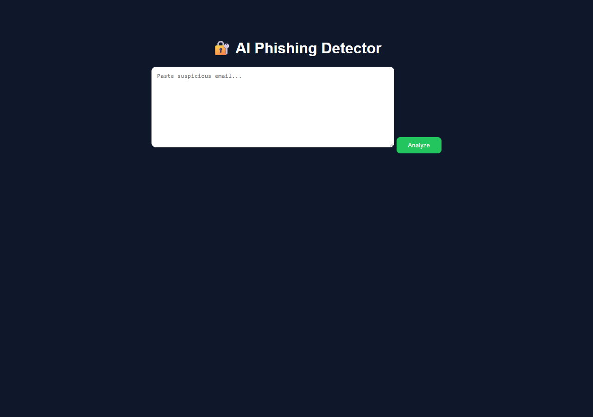
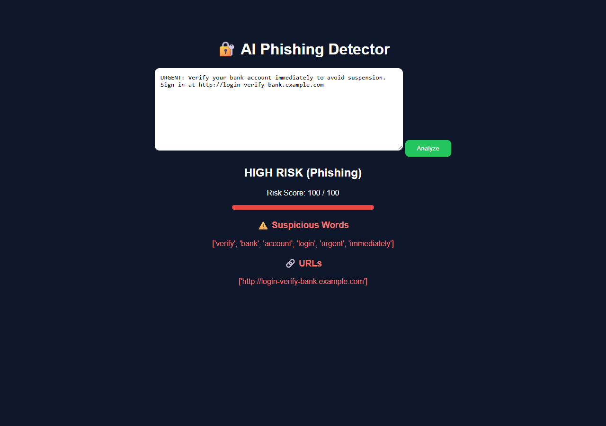
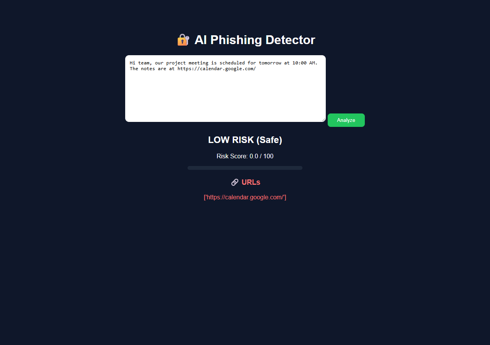
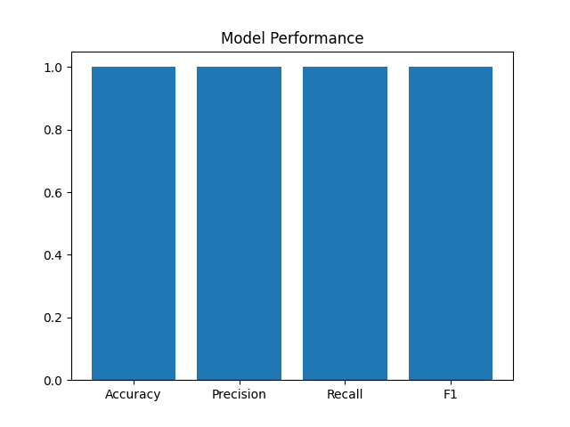
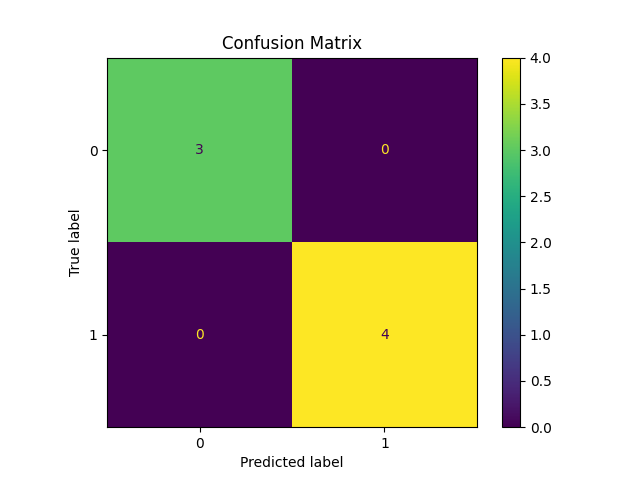
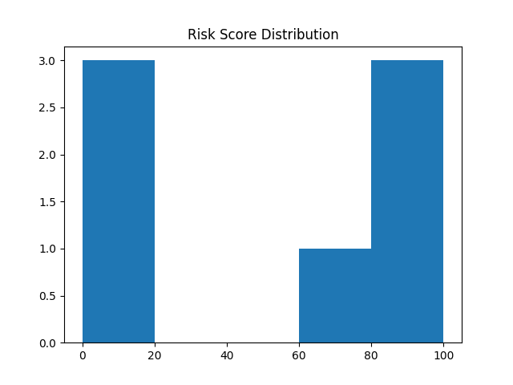
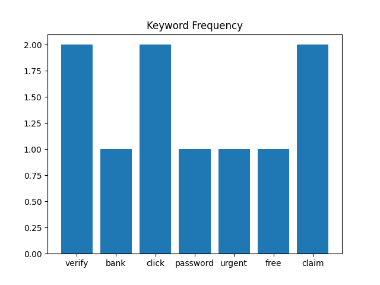

# Phishing Detector

### Triage suspicious email text with a local DistilBERT model and transparent URL and keyword signals.

Phishing Detector is a small Flask application for analyzing pasted email text. It combines a two-class DistilBERT classifier with simple keyword and URL heuristics, then shows a risk score, a risk label, matched terms, and extracted links.

[](https://www.python.org/)
[](https://flask.palletsprojects.com/)
[](https://huggingface.co/docs/transformers)
[](https://github.com/swarabhavsar28/phishing-detector)

> **Use as a learning and triage aid.** A low-risk result does not prove that a message or link is safe. Review suspicious messages through a trusted channel and do not enter credentials after following an unexpected link.

---

## At a glance

| Property | Details |
| --- | --- |
| **Input** | Email or message text pasted into the web form |
| **Analysis** | DistilBERT class confidence, keyword matches, and basic URL pattern checks |
| **Output** | Risk label and score, matched suspicious words, and extracted HTTP(S) URLs |
| **Web stack** | Python and Flask with a Jinja template and CSS |
| **Model location** | `model/hf_model/` at runtime; model artifacts are excluded from Git |

## Application screenshots

These screenshots were captured from the application running locally, using example text in the form.

**Input form**

<p align="center"></p>

**Example phishing message**

<p align="center"></p>

**Example ordinary message**

<p align="center"></p>

The examples show the output for specific sample inputs; they are not guarantees about how other messages will be classified.

## About the project

Phishing messages often combine urgent language, requests for account details, and links that imitate trusted services. This project demonstrates a compact, inspectable approach to triaging that content: a trained text classifier provides a signal, while simple rules make some matched words and URL patterns visible to the user.

The app analyzes text submitted by the user. It does not connect to an inbox, visit links, check a domain reputation service, or block messages in a mail client.

## Features

- **Email-text classification:** submit a message through a single-page Flask form.
- **Transformer inference:** tokenize the text and run it through a locally loaded DistilBERT sequence classifier.
- **Combined risk score:** blend the model-derived score with keyword and URL rule scores, capped at 100.
- **Readable result:** show a high, medium, or low risk label and a score out of 100.
- **Visible indicators:** list matched suspicious words and HTTP(S) URLs found in the submitted text.
- **Training and visual scripts:** train a model with the included Hugging Face `Trainer` script and regenerate the included diagnostic charts.

## How it works

```mermaid
flowchart LR
    A[Paste email text] --> B[Flask form]
    B --> C[DistilBERT tokenizer]
    C --> D[Sequence classifier]
    B --> E[Keyword matching]
    B --> F[HTTP(S) URL extraction and simple URL rules]
    D --> G[Combine scores and cap at 100]
    E --> G
    F --> G
    G --> H[Risk label, score, matched words, URLs]
    H --> I[Jinja result page]
```

The inference code calculates the model component from the predicted class confidence: confidence is used directly for class `1`, and inverted for class `0`. It then adds 10 points per matched phishing keyword, 15 per matched scam word, and URL rule points. The combined score is capped at 100.

URL rules add points for an `http://` URL, hostnames containing `login`, `verify`, or `bank`, and hostnames containing a hyphen or more than two dots. These are string-based signals only; the app does not resolve or visit the URL.

| Final score | Displayed label |
| ---: | --- |
| 70–100 | `HIGH RISK (Phishing)` |
| 40–69.99 | `MEDIUM RISK` |
| 0–39.99 | `LOW RISK (Safe)` |

## Technology stack

| Component | Technology | Role |
| --- | --- | --- |
| Web server | Flask | Handles the `/` GET and POST form route |
| Template | HTML with Jinja | Renders the form and prediction result |
| Styling | CSS | Styles the page in `static/style.css` |
| Text model | DistilBERT sequence classifier | Produces two-class logits for submitted text |
| Tokenization and inference | Hugging Face Transformers, PyTorch | Loads the local tokenizer/model and computes class scores |
| Training data and loop | Hugging Face Datasets and Transformers `Trainer` | Loads `SetFit/enron_spam` and fine-tunes the classifier |
| Evaluation visuals | Matplotlib and scikit-learn | Creates the sample charts in `evaluate_visuals.py` |

## Project structure

```text
phishing-detector/
├── app.py                         # Flask application and form route
├── train_hf.py                    # Fine-tunes and saves the classifier
├── evaluate_visuals.py            # Generates the sample charts
├── utils/
│   └── predictor.py               # Model inference and scoring rules
├── templates/
│   └── index.html                 # Input form and result template
├── static/
│   └── style.css                  # Page styling
├── docs/
│   └── screenshots/               # Captured local application screenshots
├── graph_*.png                    # Saved evaluation-script visuals
├── model/hf_model/                # Local model files; ignored by Git
├── results/checkpoint-*/          # Local training checkpoints; ignored by Git
└── time pass                     # Legacy scratch file, not used by the app
```

There is no dependency manifest or license file in the repository. `model/hf_model/` and the training checkpoints are local artifacts excluded by `.gitignore`.

## Model information

The training script starts from `distilbert-base-uncased` and loads the `SetFit/enron_spam` dataset. It renames the `label` column, takes a randomized 80/20 split of the dataset's `train` split, then selects up to 6,000 training and 1,500 evaluation examples. The script tokenizes with truncation and fixed padding to 256 tokens, configures two output classes, and declares three training epochs with batch sizes of eight.

At inference, `utils/predictor.py` loads `AutoTokenizer` and `AutoModelForSequenceClassification` from the relative path `model/hf_model`. The tokenizer and model are loaded when the predictor module is imported. Input is tokenized with truncation and dynamic padding, passed to the model, and converted to class probabilities with softmax.

`predict_email` treats class index `1` as the positive/phishing class and class index `0` as the negative/safe class when it derives model risk. `train_hf.py` passes the dataset's label values through without remapping, so confirm those label semantics for the dataset and saved model you use. The score shown by the app is a heuristic composite, **not a calibrated probability**.

### Model files

`model/hf_model/` and `results/checkpoint-*/` are ignored by Git. This checkout has local model files, but they are not part of a normal clone. The repository does not currently document a downloadable model artifact. To run a fresh clone, either:

1. Put a compatible tokenizer and sequence-classification model in `model/hf_model/`, or
2. Run the included training script to create that directory (see setup below).

The training path downloads the base model and dataset from Hugging Face, so it requires network access and can take time and disk space. Training checkpoints are not required for inference.

## Evaluation and visualizations

The repository includes four charts generated by `evaluate_visuals.py`:

| Chart | What the script plots |
| --- | --- |
| `graph_metrics.png` | Accuracy, precision, recall, and F1 calculated on seven hard-coded examples |
| `graph_confusion.png` | Confusion matrix for those same seven examples |
| `graph_distribution.png` | Risk scores for those same seven examples |
| `graph_keywords.png` | Keyword counts entered as fixed values in the script |

<p align="center">
  
  
</p>
<p align="center">
  
  
</p>

These are **illustrative script outputs, not a representative benchmark**. The evaluation script uses only seven manually written messages and manually assigned labels; keyword counts are hard-coded. The script prints no classification report or saved evaluation dataset. The charts therefore should not be used to claim general accuracy or real-world phishing detection performance.

The currently saved metrics chart displays **accuracy 1.00, precision 1.00, recall 1.00, and F1 1.00** on that seven-message sample. Its confusion matrix is 3 true negatives, 4 true positives, and no errors. These values describe only those examples and are not a held-out benchmark.

To regenerate the charts after the model is available:

```bash
python evaluate_visuals.py
```

## Installation and setup

### Prerequisites

- Python and `pip` (the repository does not declare a minimum Python version).
- A compatible local model in `model/hf_model/`, or network access to train one using Hugging Face.

Create and activate a virtual environment from the repository root.

**Windows PowerShell**

```powershell
python -m venv .venv
.\.venv\Scripts\Activate.ps1
```

**macOS / Linux**

```bash
python -m venv .venv
source .venv/bin/activate
```

There is no dependency manifest in the repository yet. Install the packages used by the app, training script, and evaluation script:

```bash
python -m pip install --upgrade pip
python -m pip install Flask torch transformers datasets numpy scikit-learn matplotlib
```

If you already have a compatible model, place its files under `model/hf_model/` and skip training. Otherwise, from the repository root run:

```bash
python train_hf.py
```

When training completes, the script saves the tokenizer and model to `model/hf_model/`. Then start the Flask development server:

```bash
python app.py
```

Open [http://127.0.0.1:5000](http://127.0.0.1:5000) in your browser. The app uses relative model paths, so run commands from the repository root. `app.py` enables Flask debug mode; use it for local development only.

## Usage

1. Open the local app and paste the text of an email or message into the text area.
2. Select **Analyze**.
3. Review the risk label and score, then inspect the displayed matched words and extracted URLs if present.

The form accepts message text, not a standalone URL field. A message can include a URL, and the app will apply its basic string-based URL rules to links it extracts. Never use a result as the only basis for trusting a message or link.

## Limitations and future work

- The training dataset is an email spam dataset, not a purpose-built, independently validated phishing corpus.
- The scoring weights and label thresholds are fixed in source code and are not calibrated against a production dataset.
- Keyword and URL checks are simple substring and hostname patterns. They can miss new attacks and flag benign content.
- The app does not inspect page content, redirects, TLS certificates, DNS, sender authentication, or domain reputation.
- The seven-example visualization script is too small for meaningful performance claims.
- Model loading uses a hard-coded local path, and the model is not distributed through this Git repository.
- Flask debug mode is enabled; the app has no production deployment configuration.

Possible next steps include adding a documented model artifact and dependency lock, evaluating against a held-out phishing dataset, reporting per-class metrics, making model paths configurable, and adding production-safe serving and input handling.

## Contributing

Contributions are welcome. Open an issue to discuss a change, or submit a pull request with a focused improvement and a clear description. For model or evaluation changes, include the dataset split and reproducible measurement method; do not present sample outputs as general performance results.

## License

No license file is present in this repository. Until a license is added, reuse and redistribution permissions are not specified.

## Author

[GitHub profile](https://github.com/swarabhavsar28) · [Project repository](https://github.com/swarabhavsar28/phishing-detector)
